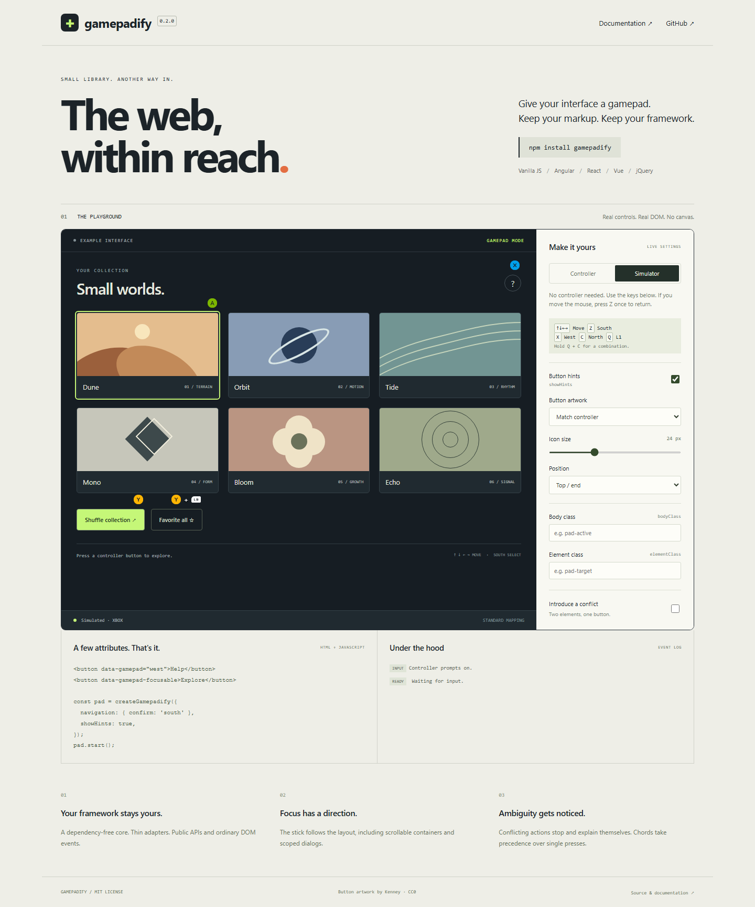

# Gamepadify

[](https://github.com/gevmarlen/gamepadify/actions/workflows/ci.yml)
[](https://gevmarlen.github.io/gamepadify/)
[](LICENSE)

Give your interface a gamepad. Typed button bindings, directional focus and controller prompts for ordinary DOM elements.

**[Try the playground](https://gevmarlen.github.io/gamepadify/)** · [API reference](docs/api.md) · [Smaller builds](docs/bundles.md) · [Runnable examples](examples/README.md) · [Compatibility](docs/compatibility.md)



- A dependency-free core, with separate Angular, React, Vue and jQuery adapters.
- Data attributes, selector maps and programmatic registration.
- Physical button names and explicit Xbox, PlayStation and Switch aliases.
- Chords, conflict diagnostics, scroll-aware navigation and dialog scopes.
- Customizable PNG prompts, a real DOM focus ring and automatic input-mode switching.
- ESM, CommonJS, TypeScript declarations and a minified browser script.

## Install

Version 0.2.0 is distributed through [GitHub Releases](https://github.com/gevmarlen/gamepadify/releases/tag/v0.2.0); npm publication is deferred. Download the core archive and install it locally:

```sh
npm install ./gamepadify-0.2.0.tgz
```

Install an adapter archive alongside it when needed. The registry commands and CDN examples below apply after npm publication.

```ts
import { createGamepadify } from 'gamepadify';
import 'gamepadify/styles.css';

const pad = createGamepadify();
pad.start();
```

```html
<button data-gamepad="south">Save</button>
<button data-gamepad="left-shoulder+north">More</button>
```

Connect a controller and press any button. The first press only enters gamepad mode; release it before activating an action. Moving the mouse, pressing a keyboard key or touching the page restores the ordinary interface.

### Browser script

Keep the script and stylesheet on the same fixed version. PNG URLs are relative to the stylesheet; no asset-base configuration is needed.

```html
<link rel="stylesheet"
  href="https://cdn.jsdelivr.net/npm/gamepadify@0.2.0/dist/gamepadify.css">

<button data-gamepad="south">Save</button>

<script src="https://cdn.jsdelivr.net/npm/gamepadify@0.2.0/dist/gamepadify.min.js"></script>
<script>
  const pad = Gamepadify.createGamepadify();
  pad.start();
</script>
```

The npm/CDN URLs become available when the corresponding npm version is published. Release archives are also available on [GitHub Releases](https://github.com/gevmarlen/gamepadify/releases).

**0.2.0 distribution:** this release is available on GitHub. npm publication is deferred; download and install its `.tgz` archives, or use the standalone browser archive locally.

### Smaller builds

The default import keeps all features. For bindings alone, change it to `gamepadify/core` and use `gamepadify/core.css`: the standalone JS is **6.8 kB gzip**, compared with **9.4 kB** for the full build. The API stays the same.

`gamepadify/navigation` adds spatial navigation without prompts; `gamepadify/hints` adds prompts without navigation. Every framework adapter exposes the same suffixes. See [build choices, sizes and examples](docs/bundles.md).

## Bindings

Choose the approach that fits your application:

```ts
const pad = createGamepadify({
  bindings: {
    '#save': 'south',
    '#more': ['left-shoulder', 'north'],
  },
});

const unbind = pad.bind(document.querySelector('#custom')!, {
  button: 'west',
  action: ({ element }) => element.dispatchEvent(new Event('open')),
  hint: { size: 32, placement: 'right' },
});

pad.start();
unbind();
```

Explicit registrations override selector maps, which override data attributes. Registering the same element twice does not create a duplicate-element conflict. Multiple explicit registrations merge their fields in registration order, so a button directive and a focusable directive can coexist.

The default action focuses the element and calls `.click()`. A custom `action` replaces the click. It should update your application through its normal public API.

### Buttons and chords

| Position | Xbox alias | PlayStation alias | Switch alias |
| --- | --- | --- | --- |
| `south` | `xbox:a` | `ps:cross` | `switch:b` |
| `east` | `xbox:b` | `ps:circle` | `switch:a` |
| `west` | `xbox:x` | `ps:square` | `switch:y` |
| `north` | `xbox:y` | `ps:triangle` | `switch:x` |

Other physical names: `left-shoulder`, `right-shoulder`, `left-trigger`, `right-trigger`, `left-stick`, `right-stick`, `select`, `start`, `home`, and `dpad-up/down/left/right`.

Aliases always denote a physical position, regardless of the connected controller. Plain `A` or `X` is rejected. In TypeScript use a typed tuple for a chord; in HTML use `+`:

```ts
import type { Chord } from 'gamepadify';

const favorite: Chord = ['left-shoulder', 'north'];
```

Button order does not matter. When a single binding overlaps a longer chord, only the ambiguous action waits for the default 80 ms chord window. The longest match wins. Releasing a chord does not fire its shorter bindings; adding a button after an action has already fired does not trigger another overlapping action. You can hold a modifier and repeatedly press the other button. Equally long overlapping matches are blocked and reported.

These are simultaneous controller combinations, not keyboard shortcuts or input sequences.

## Navigation and dialogs

```html
<button data-gamepad-focusable>First</button>
<button data-gamepad-focusable>Second</button>
```

```ts
const pad = createGamepadify({
  navigation: {
    confirm: 'east',
    selector: '[data-gamepad-focusable]',
    dpad: false,
  },
});

dialog.showModal();
const closeScope = pad.pushScope(dialog);
dialog.addEventListener('close', closeScope, { once: true });
```

Navigation is opt-in; `confirm` is required. It is reserved throughout the active scope, including inside chords. A conflicting binding and that reserved action are blocked until the conflict disappears. Enabling D-pad navigation reserves its four buttons too.

The left stick chooses one direction using its dominant axis. Navigation prefers elements in the same directional lane, then the nearest rectangle, then DOM order. It starts at the current eligible DOM focus or the first eligible element. Offscreen targets scroll into view, including nested containers. There is no wraparound.

Default stick thresholds are **0.55** to engage and **0.35** to release. Repeat starts after **300 ms**, then every **100 ms**. Closing a scope restores the previous scope and available focus. Native `<dialog>` overlays are supported when the dialog is passed to `pushScope`.

## Options

| Option | Default | Effect |
| --- | --- | --- |
| `showHints` | `true` | Show button prompts in gamepad mode |
| `bodyClass` | `''` | Space-separated classes on `body` in gamepad mode |
| `elementClass` | `''` | Classes on registered bindings and explicit focusable elements in the active scope |
| `navigation` | disabled | Enable spatial focus and reserve a confirm button |
| `hints.size` | `24` | Prompt size in CSS pixels |
| `hints.placement` | `'top-end'` | Position relative to the element |
| `hints.offset` | `6` | Gap in CSS pixels |
| `hints.skin` | `'auto'` | Detected family, fixed family or a custom skin |
| `family` | `'auto'` | Override detected device family |
| `chordWindow` | `80` | Ambiguous-combination window in milliseconds |
| `warnings` | `true` | Log diagnostics through `console.warn` |

`showHints: false` keeps input, diagnostics and the focus ring enabled. Class options accept multiple tokens. Original classes survive mode changes, reconfiguration and destruction; the library removes only the tokens it claimed. Dynamic SPA elements receive the current configuration automatically.

```ts
pad.configure({
  showHints: false,
  bodyClass: 'using-gamepad dim-pointer-ui',
  elementClass: 'gamepad-action',
});
```

See [the API reference](docs/api.md) for root selection, profiles, offsets, events and complete types.

## Framework adapters

Frameworks are peer dependencies and are never bundled. The adapters use public lifecycle APIs and share one core controller.

| Package | Supported range | Integration |
| --- | --- | --- |
| `gamepadify-angular` | Angular 20–22 | Standalone directives and environment providers |
| `gamepadify-react` | React 18–19 | Provider and typed callback refs |
| `gamepadify-vue` | Vue 3.3–3.5 | Directives, plugin and composable |
| `gamepadify-jquery` | jQuery 3.7 and 4 | Explicit plugin installation |

### Angular

```sh
npm install gamepadify gamepadify-angular
```

```ts
import { Component, signal } from '@angular/core';
import { bootstrapApplication } from '@angular/platform-browser';
import {
  GamepadDirective,
  GamepadFocusableDirective,
  provideGamepadify,
} from 'gamepadify-angular';

@Component({
  selector: 'app-root',
  imports: [GamepadDirective, GamepadFocusableDirective],
  template: `
    <button [gamepad]="'west'" (click)="save()">Save</button>
    <button gamepadFocusable (click)="next()">Continue</button>
  `,
})
class App {
  saved = signal(false);
  save() { this.saved.set(true); }
  next() {}
}

bootstrapApplication(App, {
  providers: [provideGamepadify({ navigation: { confirm: 'south' } })],
});
```

Add `gamepadify/styles.css` to your application stylesheet imports. Inject `GamepadifyService` to access `.controller`. Polling runs outside Angular's zone; normal template events and signals still update the UI. The package is compiled with Angular 20 in Partial-Ivy/APF format and checked against Angular 20, 21 and 22, including zoneless hydration.

### React

```sh
npm install gamepadify gamepadify-react
```

```tsx
import { GamepadProvider, useGamepad } from 'gamepadify-react';
import 'gamepadify/styles.css';

function SaveButton() {
  const ref = useGamepad<HTMLButtonElement>('west');
  return <button ref={ref} onClick={() => console.log('Saved')}>Save</button>;
}

export function App() {
  return <GamepadProvider><SaveButton /></GamepadProvider>;
}
```

Use `useGamepad({ focusable: true })` for navigation targets and `useGamepadController()` for scopes or subscriptions. Memoize options and object bindings when appropriate. The provider supports SSR and React Strict Mode; it starts in an effect and stops on cleanup.

### Vue

```sh
npm install gamepadify gamepadify-vue
```

```ts
import { createApp } from 'vue';
import { createGamepadifyPlugin } from 'gamepadify-vue';
import 'gamepadify/styles.css';
import App from './App.vue';

createApp(App)
  .use(createGamepadifyPlugin({ navigation: { confirm: 'south' } }))
  .mount('#app');
```

```vue
<script setup lang="ts">
import { useGamepadify } from 'gamepadify-vue';
const pad = useGamepadify();
function save() { console.log('Saved'); }
</script>

<template>
  <button v-gamepad="'west'" @click="save">Save</button>
  <button v-gamepad="['left-shoulder', 'north']">More</button>
  <button v-gamepad-focusable>Continue</button>
</template>
```

The plugin starts after a directive or composable mounts and stops when the final consumer unmounts. Create one plugin per app/SSR request. The composable exposes the controller; global directive types are exported for Vue language tooling.

### jQuery

```sh
npm install gamepadify gamepadify-jquery jquery
```

```ts
import $ from 'jquery';
import { installGamepadify } from 'gamepadify-jquery';
import 'gamepadify/styles.css';

installGamepadify($);
$('#app').gamepadify({ bindings: { '#save': 'west' } });
const pad = $('#app').gamepadify('instance');
$('#app').gamepadify('configure', { showHints: false });
$('#app').gamepadify('destroy');
```

Install `@types/jquery` for TypeScript projects. Plugin installation is explicit and idempotent. Destroy the controller when removing its root.

## Prompts, skins and focus

The bundled PNG artwork is [Kenney Input Prompts](https://kenney.nl/assets/input-prompts), licensed CC0. It includes Xbox, PlayStation and Switch sets. These are community assets, not official manufacturer assets. Unknown standard controllers use neutral text labels. Missing or failed images fall back to text.

```ts
import type { Skin } from 'gamepadify';

const skin: Skin = {
  name: 'My controls',
  glyphs: {
    south: '/controls/accept.png',
    north: {
      url: '/controls/atlas.png',
      label: 'More',
      atlas: { x: 32, y: 0, width: 32, height: 32, sheetWidth: 256, sheetHeight: 64 },
    },
  },
};

pad.configure({ hints: { skin, size: 28, placement: 'bottom-end', offset: 8 } });
```

Bindings can override `hint` settings individually. Prompts live in a separate, `aria-hidden`, pointer-transparent layer; React/Vue/Angular-owned element contents are untouched.

```css
:root {
  --gamepadify-size: 28px;
  --gamepadify-focus-color: #b9f56b;
  --gamepadify-focus-radius: 6px;
  --gamepadify-focus-width: 2px;
  --gamepadify-focus-shadow: #172026;
  --gamepadify-z-index: 2147483000;
}
```

An explicit `hints.size` or per-binding `hint.size` overrides the CSS size. The real DOM focus is preserved; gamepad mode replaces the native outline with the configurable ring.

## Diagnostics and lifecycle

```ts
const off = pad.on('warning', diagnostic => {
  console.log(diagnostic.code, diagnostic.buttons, diagnostic.elements);
});
const state = pad.getState();

off();
pad.stop();
pad.start();
pad.destroy();
```

Identical normalized bindings on different visible, available elements are blocked. Warnings include the involved elements and are emitted again only when conflict membership changes. Hidden, disabled, inert, clipped or offscreen elements do not create screen conflicts. Reserved navigation buttons have stricter scope-wide validation.

Importing any package is SSR-safe. Constructing a controller does not read browser globals. `start()` is explicit for vanilla JavaScript; adapters start in the client lifecycle. `stop()` releases browser resources and permits restart. `destroy()` also discards registrations and subscriptions and is final.

Input processing pauses when the page is hidden or unfocused. Disconnects, input-mode changes, configuration changes and scope changes reset pending combinations.

## Browser limits

- Use HTTPS or localhost. Browser permissions and iframe `gamepad` Permissions Policy can restrict access.
- Recognition uses the browser's `Gamepad.id`. Bluetooth, USB, drivers and XInput can expose different IDs for the same hardware. Family detection is best effort; use `family`, `hints.skin` or custom `profiles` to override it.
- Nonstandard controller mappings need a matching `DeviceProfile`; they are not guessed.
- Polling cannot manufacture trusted user activation. File pickers, fullscreen, clipboard and similar protected APIs may still require a real browser-recognized gesture.
- Home/system buttons may be intercepted by the OS. Browser extensions and keyboard-to-gamepad tools may change behavior.
- This release targets light DOM, document scrolling and ordinary scroll containers. Automatic traversal across shadow roots and iframes is not provided.
- Automated tests use a controlled input source. Physical controllers have **not** been hardware-certified for this release.

See [architecture](docs/architecture.md), [compatibility evidence](docs/compatibility.md) and [contributing](CONTRIBUTING.md).

## License

MIT for code. CC0 for the bundled Kenney artwork; see [THIRD_PARTY_NOTICES.md](THIRD_PARTY_NOTICES.md). Controller brand names identify compatible layouts and do not imply endorsement.
